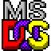

# MBFU — загрузочная флешка MS-DOS

[](https://github.com/sementsul/ms-dos/actions/workflows/build.yml)
[](https://github.com/sementsul/ms-dos/actions/workflows/pages.yml)
[-blue.svg)](LICENSE)

Графическая утилита для создания загрузочных USB-флешек **MS-DOS 5.00 / 6.22**.
Сайт проекта: https://ms-dos.su/



## Что в репозитории, а что нет

Здесь лежат **сайт** (`docs/`), **генераторы сайта** (`tools/`, `content/`) и
**исходники MBFU 1.x** (`MBFU_clean/`), опубликованные ранее по MIT.

**MBFUTool 2.0 — проприетарная программа.** Её исходный код в репозитории
отсутствует: распространяются только готовые сборки (Trial и полная версия).
Условия использования — [EULA](LICENSE). Лицензия MIT к версии 2.x не
применяется; для ранее опубликованного кода 1.x она сохранена в
[LICENSE-MIT-1.x.md](LICENSE-MIT-1.x.md) и отозвана быть не может.

## Возможности

- Выбор USB-накопителя (модель, размер, буква) через PowerShell, без мигающих окон
- MS-DOS 6.22 / 5.00, метка тома
- Norton Commander 4.0 — опционально, галочка включена по умолчанию
- Обязательное принятие лицензий MS-DOS и Norton Commander (в установщике и в программе)
- Блокировка системного диска, тройное подтверждение перед форматированием
- Понятные ошибки вместо кодов («флешка больше 4 ГБ для FAT16» и т.д.)
- Автономный EXE: Python и установка чего-либо не нужны

## Скачать

- **Trial 2.0** — https://ms-dos.su/#trial (30 дней, все функции, без ключа)
- **Полная версия** — https://boosty.to/mbfu (разовая покупка)
- Сборки 1.x — в [Releases](https://github.com/sementsul/ms-dos/releases)

## Собрать сайт

```bat
cd tools
python gen_site.py      :: 10 страниц × 2 языка
python gen_seo.py       :: 100 статей + каталоги
python gen_sitemap.py   :: карты сайта и robots.txt
python check_site.py    :: битые ссылки, JSON-LD, токены
```

Подробности — в [DEPLOY.md](DEPLOY.md), правовые требования — в
[COMPLIANCE.md](COMPLIANCE.md).

## Важно про сторонние лицензии

- **MS-DOS 5.00/6.22** — собственность Microsoft. **Norton Commander** — собственность
  правообладателя линейки Norton. **BEN-утилиты, DOSBox, SDL, RMPARTUSB** — их авторов.
  Эти файлы в репозитории **отсутствуют сознательно**: используйте свои законные копии,
  раскладка — в [PAYLOAD.md](PAYLOAD.md).
- **DOSBox** поставляется в составе 2.0 в неизменном виде под GPLv2; исходники —
  на dosbox.com. Условия и ссылки: https://ms-dos.su/licenses.html
- Программа при первом запуске требует принять лицензионное соглашение, иначе
  работа заблокирована.